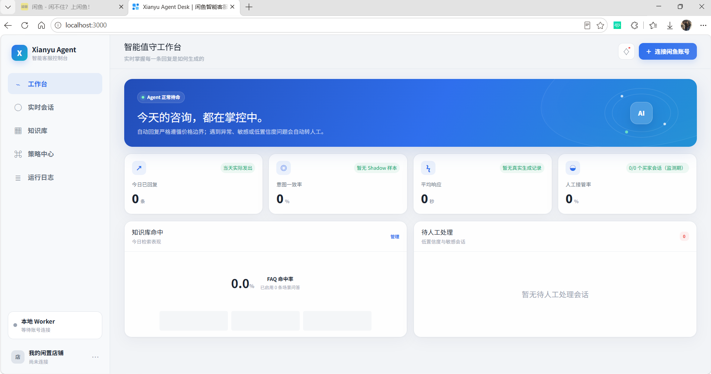
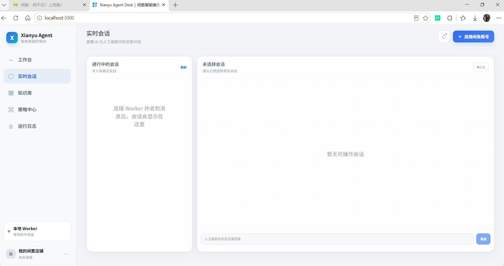
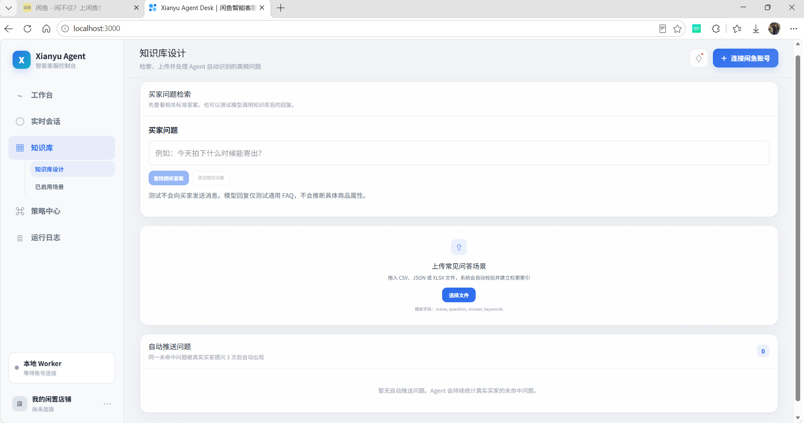
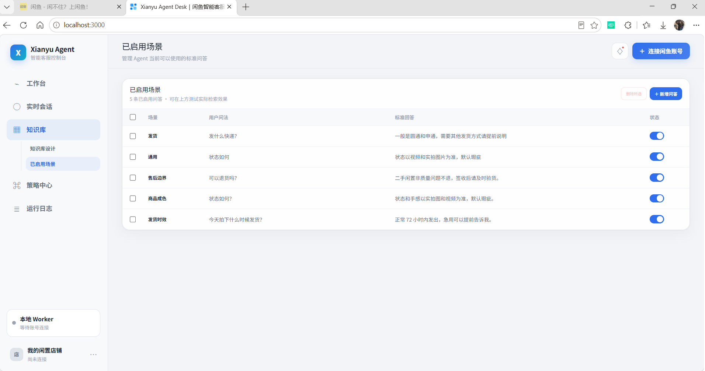
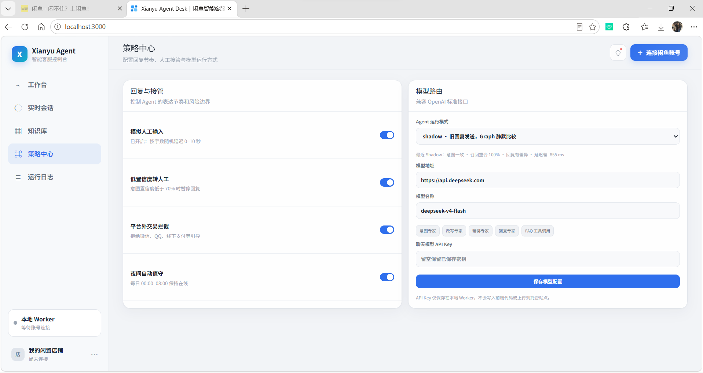
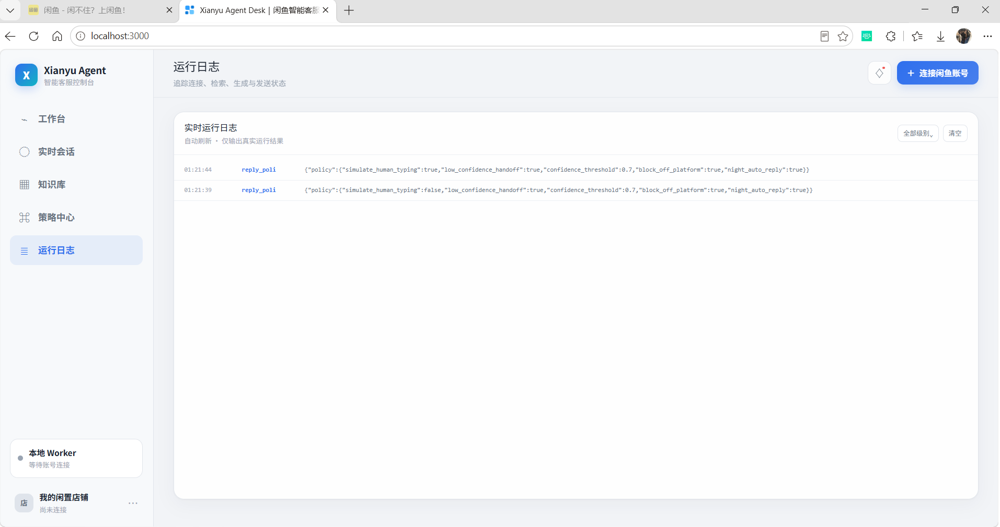

# Xianyu Agent Desk

一套可实际接入闲鱼网页消息通道的智能客服控制台，包含：

- 意图识别：规则优先、模型兜底，支持议价、发货、成色、售后、库存等意图。
- 多轮改写：结合商品与最近对话，补全省略指代后再检索。
- 混合粗排：BM25 与 Embedding 向量召回通过加权 RRF 融合；默认使用本地中文向量模型，无需 API Key；模型异常时降级为 BM25 并记录后端日志。
- 模型精排：对候选证据重排序，Top 3 进入回复专家。
- 安全生成：价格上下限为硬约束，平台外交易引导会被拦截。
- 本地连接：Cookie 与模型密钥仅保存到本地 Worker，不写入前端。

## 目录

```text
app/                       Web 控制台
services/xianyu-worker/    闲鱼连接、本地 API、Agent 流水线
samples/faqs.csv           FAQ 导入模板
docker-compose.yml         Worker 容器启动配置
```

## Windows 本机启动（已迁移）

项目及配置统一位于 `D:\xianyu\_agent`。双击该目录中的 **start.cmd**，等待就绪后会自动打开 `http://127.0.0.1:3000`。前端和 Worker 在后台运行；关闭浏览器不会停止服务。双击 **stop.cmd** 可停止本目录启动的服务（如正在值守，会中断监听）。

启动器会检查 3000 和 8787 端口，不会自动终止其他项目；若旧目录的程序仍占用端口，请先关闭旧程序再启动。日志保存在 `logs/dashboard.*.log` 和 `logs/worker.*.log`。页面打开后，可在界面连接闲鱼账号；启动脚本本身不会自动接入账号或发送消息。

也可以分别在两个 PowerShell 窗口中启动：

```powershell
# 窗口 1：Worker
Set-Location D:\xianyu\_agent
powershell.exe -NoProfile -ExecutionPolicy Bypass -File .\services\xianyu-worker\run.ps1
```

```powershell
# 窗口 2：网页控制台
Set-Location D:\xianyu\_agent
powershell.exe -NoProfile -ExecutionPolicy Bypass -File .\start-dashboard.ps1
```

Worker 默认监听 `http://127.0.0.1:8787`，健康检查为 `/health`。启动脚本固定工作目录和数据目录，加载已有 `.env`；已保存的 `data/settings.json` 中的聊天模型与 Cookie 配置继续生效。**不要用 `.env.example` 覆盖现有 `.env`。**

依赖要求：Python 3.10+、Node.js 22.13+ 和 pnpm。当前电脑的运行依赖已在新目录重建。脚本优先使用 PATH 中的 Node/pnpm，找不到时尝试当前用户的 Codex 自带运行时。如果卸载 Codex，需要自行安装 Node.js 和 pnpm。

重新安装依赖（仅需要时）：

```powershell
Set-Location D:\xianyu\_agent
. .\scripts\runtime.ps1
pnpm install --frozen-lockfile
python -m venv .\services\xianyu-worker\.venv
& .\services\xianyu-worker\.venv\Scripts\python.exe -m pip install -r .\services\xianyu-worker\requirements.txt
```

打开 `http://127.0.0.1:3000`，点击“连接闲鱼账号”，填写：

1. 已登录 `https://www.goofish.com` 的完整 Cookie；
2. 兼容 OpenAI Chat Completions 的模型 API Key、Base URL 和模型名；
3. Worker 地址 `http://127.0.0.1:8787`。

Embedding 已内置于后端代码：使用 FastEmbed 的 `BAAI/bge-small-zh-v1.5` 中文模型在 CPU 上生成真实语义向量，无需 API Key。首次查询会自动下载模型至 `.models`，需要联网；下载完成后可离线运行。FAQ 向量保存在 SQLite，内容更新或删除后自动失效。模型首次加载耗时较长，可先运行下面的评测脚本完成下载和预热。

数据存储位置：

- 连接与模型配置：`services/xianyu-worker/data/settings.json`（含敏感信息）
- 环境配置：`services/xianyu-worker/.env`
- 聊天记录：`services/xianyu-worker/data/chat_history.db`
- 本地模型缓存：`.models/`（已迁移，无需重新下载）
- FAQ 原文：项目根目录 `knowledge_base.json`
- FAQ 向量：`services/xianyu-worker/data/agent_desk.db` 的 `faq_vectors` 表
- 检索评测集：`evaluation/faq_retrieval_eval.json`

向量库采用 SQLite 持久化，并在当前 FAQ 规模下执行精确余弦检索，不依赖仅用于展示的模拟分数。

## 3. 获取闲鱼 Cookie

在你有权管理的闲鱼账号中登录网页版，打开浏览器开发者工具（右键打开检查界面） → 选择Network（网络） → Fetch/XHR，点击任一 goofish 请求，在 Request Headers 中复制完整 Cookie。Cookie 至少应包含 `unb`。不要把 Cookie 提交到 Git、截图或发送给他人！！！

## 4. 导入 FAQ

控制台“知识库”支持 CSV、JSON、XLSX。CSV 字段：

```text
scene,question,answer,keywords
```

可直接使用 `samples/faqs.csv`。

## 5. 检索评测

在 Worker 目录运行，确保使用同一份正式数据库：

```powershell
Set-Location D:\xianyu\_agent\services\xianyu-worker
& .\.venv\Scripts\python.exe .\evaluate_retrieval.py
```

脚本对真实 `knowledge_base.json` 执行检索，输出 `Recall@1/3/5`、`MRR` 和回答正确率。回答正确率按评测集中的必含/禁含事实短语确定性判分，不调用聊天模型，结果可重复。默认评测本地 BM25 + 向量混合检索；模型加载失败时报告 BM25 降级，后端日志记录原因；可用 `--output` 将完整报告保存为 JSON。

## API 摘要

- `PUT /api/config`：保存本地连接与模型配置
- `POST /api/connect` / `POST /api/disconnect`：启动或停止闲鱼监听
- `POST /api/pipeline/test`：运行完整四阶段流水线
- `GET/POST /api/faqs`、`POST /api/faqs/import`：知识库管理
- `POST /api/faqs/search`：执行 `search_faq`，参数为 `{"query":"今天拍下什么时候发货？","limit":3}`，limit 为 1–5。
- `GET /api/faq-suggestions`：读取累计出现至少 3 次的未命中买家问题；`POST /api/faq-suggestions/{id}/ignore|resolve` 用于忽略或完成处理。
- `GET /api/traces`、`GET /api/events`：运行轨迹与事件

## FAQ 工具调用与控制台测试

进入“知识库 → 知识库设计 → 买家问题检索”：

- “查找相关答案”直接执行知识库检索，不调用聊天模型，也不发送闲鱼消息。
- “测试模型回复”运行客服流水线，模型通过 `search_faq` 获取标准答案，再生成回复。测试结果显示工具是否实际执行；需要转人工或模型不可用时明确显示状态。
- 模型测试使用通用 FAQ；知识库尚不支持商品级 FAQ 隔离，商品专属事实仍需结合商品资料核对。

真实买家问题没有可靠 FAQ 答案时会按标准化问题累计，单条消息只统计一次。同一问题达到 3 次后显示在“知识库设计 → 自动推送问题”；加入知识库并填写标准回答后进入“已启用场景”。控制台检索和模型测试不参与累计。

`search_faq` 复用 BM25 与 Embedding 余弦检索，按 0.55/0.45 加权 RRF 融合。FAQ 向量持久化至 SQLite，修改或删除 FAQ 后自动失效。结果中的分数是排序信号，不是回答正确率。

“策略中心 → 模型路由”只配置聊天模型。检索算法固定在后端：BM25 与本地向量检索自动融合，前端不提供 Embedding 配置或算法分数展示。旧 settings.json 中的 embedding_* 配置不再生效。服务故障时保留 BM25 降级，并在后端日志和 API 的 `embedding_status` 中标明实际状态。

工具调用仅开放只读 `search_faq`，校验工具名及参数，最多执行 6 次工具调用、4 次模型请求。首轮要求模型调用该工具；DeepSeek 官方接口在这条调用链关闭思考模式，以兼容指定工具。`tool_calls` 与 `tool_status` 保存到执行轨迹和运行日志。工具调用完成后仍执行原有价格和平台规则检查。

当前“模拟人工输入”开关关闭时仍走原有快速模式，跳过聊天模型及工具调用；界面显示“快速模式：未调用模型”。模型接口失败时保留原有检索/模板降级回复。

验证：在项目根目录执行 `services/xianyu-worker/.venv/Scripts/python.exe -m unittest discover -s tests -p "test_*.py"`，前端执行 `pnpm test`。测试覆盖工具协议往返、非法参数、调用上限、向量缓存、服务故障降级和价格规则。单元测试使用可重复的模拟服务；真实模型验证可运行评测脚本，报告中的 `retrieval_mode` 应为 `bm25+vector`。

## 部署与安全边界

网页可以部署为展示/控制台，但真正的闲鱼 WebSocket 连接必须运行在你自己的电脑或服务器上。生产环境若需要从 HTTPS 控制台访问 Worker，请为 Worker 配置你自己的 HTTPS 反向代理、鉴权和严格 CORS；不要直接把 8787 端口暴露到公网。

闲鱼网页接口可能变化，也可能触发登录过期、滑块或风控。这些状态需要账号持有人在闲鱼网页端处理，代码不会绕过平台验证。请遵守闲鱼平台规则，仅用于你有权管理的账号。

## 界面展示

# 工作台

顶部蓝色横幅显示 Agent 待命状态，下方四张指标卡：今日已回复条数、意图一致率（来自 Shadow 模式对比）、平均响应秒数、人工接管率。下半部分左侧是知识库命中面板，展示 FAQ 命中率与已启用问答数；右侧是待人工处理队列，列出低置信度与敏感会话。



# 实时会话

左侧列表按时间倒序展示进行中的会话，右侧选中会话显示完整对话。右上角“转人工”按钮把当前会话从自动回复切到人工接管；人工接管后底部输入框可直接代卖家回复，消息通过本地 Worker 走闲鱼通道发出。



# 知识库-知识库设计

顶部是“买家问题检索”测试区：输入买家问句后，“查找相关答案”只跑知识库检索、不调聊天模型、不发闲鱼消息；“测试模型回复”跑完整客服流水线，模型通过 search_faq 取标准答案后生成回复，结果中会显示工具是否实际执行以及是否转人工。
中部支持拖入 CSV、JSON、XLSX 文件批量导入问答，CSV 字段为 scene, question, answer, keywords。底部“自动推送问题”汇总真实买家中累计出现至少 3 次的未命中问题，单条消息只计一次；运营补写标准答案后进入“已启用场景”。控制台自测和模型测试不计入累计。



# 知识库-已启用场景

表格列出当前生效的标准问答：场景、用户问法、标准回答、状态开关。示例场景包括发货（圆通/申通）、通用（以实拍图为准、默认瑕疵）、售后边界（非质量问题不退）、商品成色、发货时效（72 小时内发出）。支持批量删除、新增问答和逐条启停。



# 策略中心

回复与接管
四个独立开关，对应运行日志里的 reply_policy 字段：
开关	生效行为
模拟人工输入	开启后按字数随机延迟 0–10 秒再发送，避免机器秒回；关闭则走快速模式，跳过聊天模型与工具调用
低置信度转人工	意图置信度低于 70% 时暂停自动回复，会话挂起待人工处理
平台外交易拦截	回复中出现微信、QQ、线下支付等引导时直接拦截，不发出
夜间自动值守	每日 00:00–08:00 保持在线自动回复
模型路由
只配置聊天模型，检索算法固定在后端、前端不暴露 Embedding 参数。Agent 运行模式默认 shadow：买家消息照常由旧回复路径发送，新流水线在后台静默跑一遍并对比，不影响真实买家。模型地址、模型名称（默认 deepseek-v4-flash）、API Key 在此填写；API Key 仅保存在本地 Worker，留空则保留已存密钥。
五个子角色标签（意图专家、改写专家、精排专家、回复专家、FAQ 工具调用）标注了流水线中模型被调用的位置，便于排查是哪一环在等模型返回。



运行日志

实时滚动输出 Worker 侧事件，包括连接状态、FAQ 检索、模型请求、工具调用、策略决策和发送结果。日志按级别过滤，可一键清空；reply_policy 事件直接打印当前生效的策略 JSON，便于核对开关是否真的下发到 Worker。




## 开源说明

闲鱼连接层基于 [shaxiu/XianyuAutoAgent](https://github.com/shaxiu/XianyuAutoAgent)（GPL-3.0）修改；本项目保留完整源码与 `LICENSE`，整体以 GPL-3.0 发布。该项目同时参考了 XianyuAutoAgent README 所注明的 XianYuApis 思路。

## 迁移说明

迁移目标为 `D:\xianyu\_agent`。源码、Git 历史、`.env`、本地连接配置、知识库、商品资料、SQLite 数据库和 `.models` 缓存一并保留。`node_modules` 和 Python `.venv` 在目标路径重新创建，避免依赖旧目录的绝对路径。构建输出重新生成。

原 C 盘目录保留为迁移前备份；请以后只从 D 盘启动，避免两份数据库分别产生更新。根目录 `data/agent_desk.db` 是历史评测使用的数据，保留备查；正常启动使用 `services/xianyu-worker/data/agent_desk.db`。原 `.en`、API_key.txt 等本地文件原样保留，但 `.en` 不作为环境配置加载。密钥文件不要提交或分享。

迁移后配置是否完整与闲鱼登录是否有效是两件事；若平台 Cookie 已过期，需要在控制台更新。
